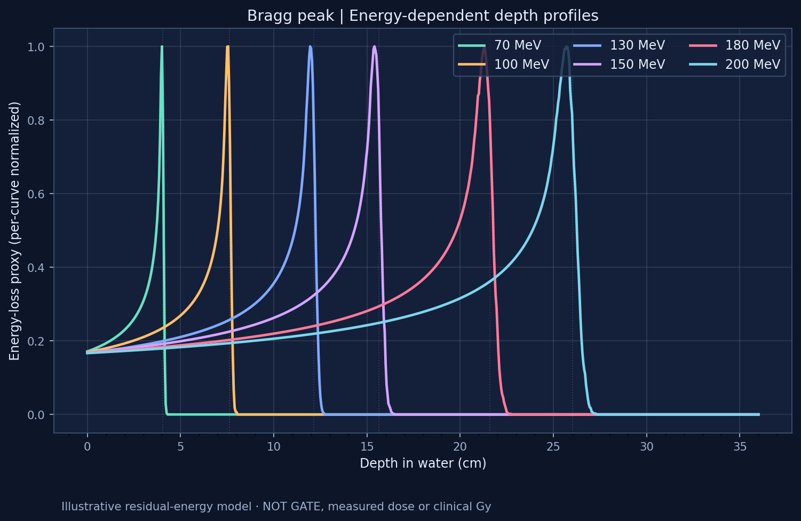
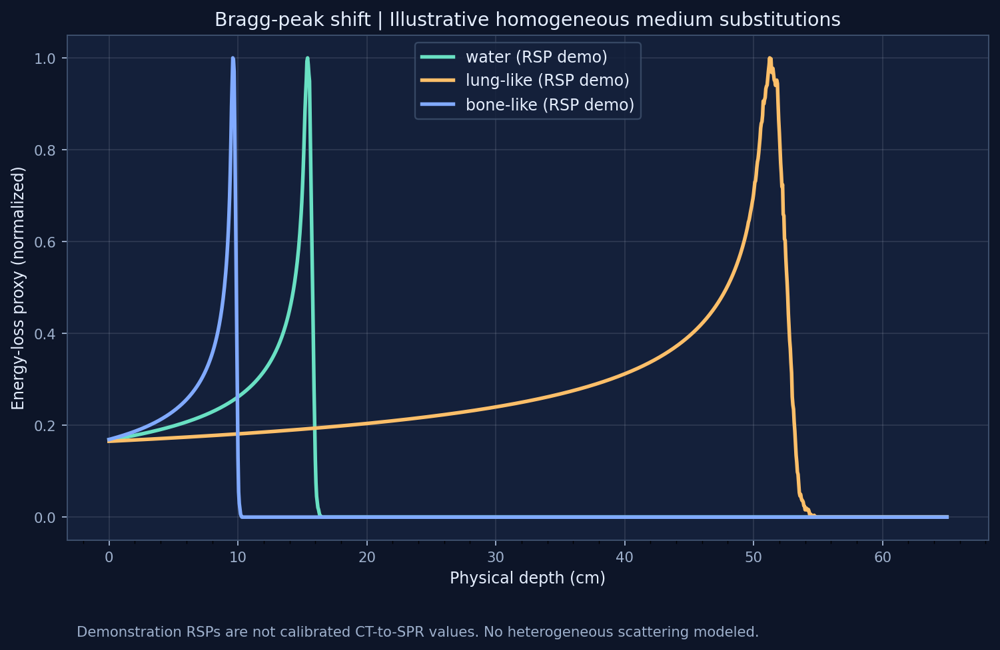
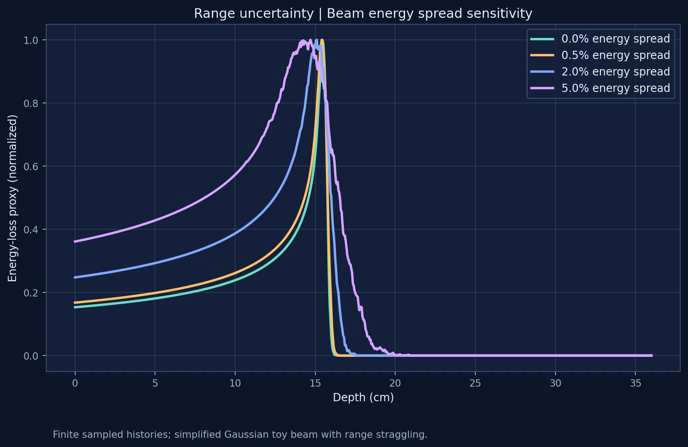
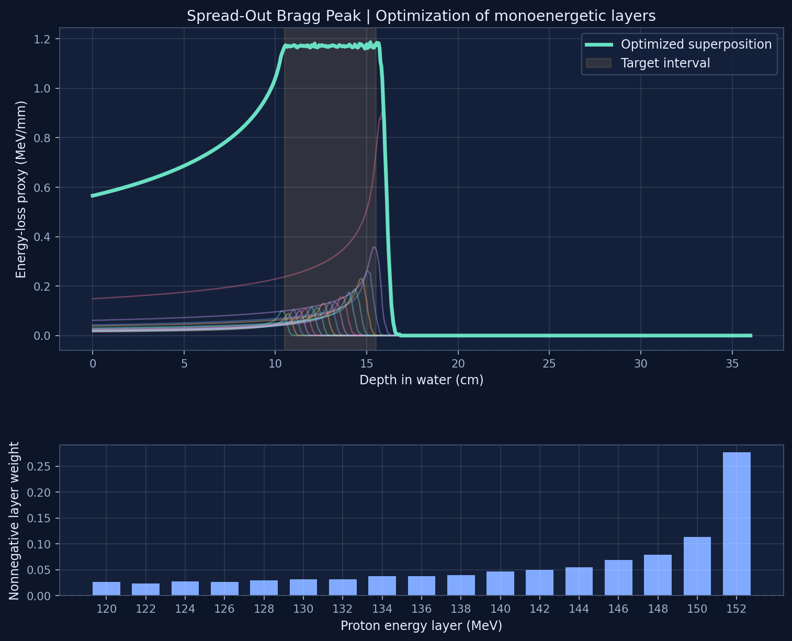
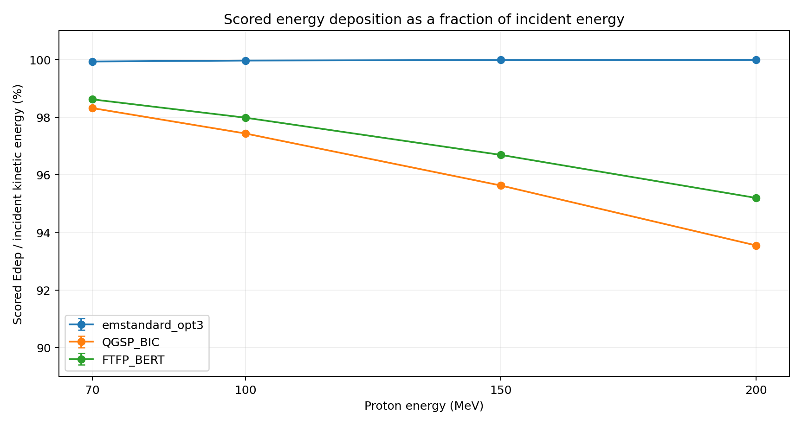

<div align="center">

# ⚛️ Bragg Peak Lab
### Proton therapy · Range uncertainty · Monte Carlo post-processing · SOBP design

**GATE / Geant4 · Python · NumPy · SciPy · Matplotlib · Interactive analysis**

[](https://github.com/BurhanKARADUMAN/Proton-Therapy-GATE-Simulation/actions)


*From a proton beam's incident energy to its distal range: reproducible models, clear scientific limitations, and transparent analysis.*

</div>

> [!IMPORTANT]
> **Scientific scope.** Illustrations in `examples/` are generated with a simplified **one-dimensional residual-energy model**, not GATE, validated proton stopping-power tables, experimental data, or clinical absorbed-dose distributions. They do **not** represent Gy, patient treatment plans, or medical advice. Original GATE macros and archived figures are retained in [`Proton_Therapy_GATE_Sim/`](Proton_Therapy_GATE_Sim/), but their numerical outputs are **not independently validated here**.

## Overview

The Bragg peak is a pronounced enhancement in charged-particle energy loss near the end of the particle's track. This project examines proton depth profiles, range shifts with simplified material stopping-power ratios, beam energy spread and a demonstration **spread-out Bragg peak (SOBP)** generated by non-negative energy-layer mixing.

| Energy sweep | Illustrative medium substitution |
|:--:|:--:|
|  |  |
| Energy-dependent range for 70–200 MeV proton beams | Synthetic water-, lung-, and bone-like ratios; **not CT calibrated** |

| Energy spread sensitivity | SOBP energy-layer optimization |
|:--:|:--:|
|  |  |
| Gaussian energy-spread sensitivity | A nonnegative weighted mixture of illustrative pristine peaks |

## Features

- **Reproducible Python profiles:** configurable incident energies, beam spread, range straggling, homogeneous demonstration RSP values, random seeds, and sample counts.
- **Strict energy bookkeeping:** the toy model integrates to the incident energy when the scoring interval fully covers the modeled stop; this is a **property of the toy model**, not a validation of Geant4 physics.
- **Quantitative depth metrics:** approximate peak depth, distal R90/R80/R20 and 80–20% falloff (explicit first-crossing definitions).
- **SOBP optimization:** constrained nonnegative least-squares combination of energy layers in a target depth interval.
- **GATE MetaImage analysis:** parse `.mhd` **and** external `.raw` files, correctly map `(z,y,x)` arrays, support beam axis and propagation sign, and export 1D depth profiles.
- **Interactive Streamlit explorer:** change energy, energy spread, range straggling, and illustrative material in your browser.
- **Unit tests + CI:** basic physics-invariants, error handling, reproducibility, and synthetic `.mhd` fixtures.

## Quick start

Requires Python 3.10+.

```bash
python -m venv .venv
# Windows PowerShell:
.\.venv\Scripts\Activate.ps1
# Linux/macOS: source .venv/bin/activate
pip install -e '.[test,ui]'
pytest -q
bragg-demo --output-dir examples/generated --histories 3000
streamlit run app.py
```

## Analyze existing GATE 3D dose outputs

The original project includes a `doz_haritasi-Dose.mhd` **header** without the `doz_haritasi-Dose.raw` file it references. Obtain the missing raw payload from your original GATE run. Do not substitute a fabricated array as a measured or Monte Carlo result.

```bash
bragg-demo --mhd /path/to/your/dose-Dose.mhd \
  --axis x --sign -1 --output-dir results/gate_analysis
```

The historical macro sends its beam in the negative **x** direction; the default `--axis x --sign -1` corresponds to that direction. Always validate scoring position, phantom origin, and coordinate frames. The reader does not transform GATE output units to Gy or register the dose grid to a CT grid.

## Scientific provenance & limitations

**Archived, as supplied:** existing GATE macros, a synthetic labelled phantom generator, overlay script, report and figures live under `Proton_Therapy_GATE_Sim/` and are retained without rewriting history. See [legacy audit](docs/LEGACY_GATE_AUDIT.md) for critical issues (bone mapped to water, missing raw payload, extremely coarse 10 mm voxels, discrepancies in output names, and limited simulated histories in one of the original macros).

**New in V2:** `braggkit/` provides a separate, independently testable illustrative energy-loss model. It uses an approximate power-law range in water, $R_{\mathrm{cm}} = 0.0022 (E/{\mathrm{MeV}})^{1.77}$. This fit is **not** a substitute for evaluated NIST PSTAR range or stopping-power tables. It neglects multiple Coulomb scattering, nonelastic interactions, secondary particles, LET/RBE, phantom inhomogeneity in 3D, CT calibration uncertainty and absolute dosimetry. The illustrative RSPs for `lung-like` and `bone-like` are not patient-specific and should not be interpreted as validated material values.

For precision work, benchmark against [NIST PSTAR](https://physics.nist.gov/PhysRefData/Star/Text/PSTAR.html) and compare fully specified GATE/Geant4 runs with phantom, material, physics list, event count and scoring geometry recorded.

## Repository map

```text
braggkit/                 # Research-grade software practices; educational physics model
app.py                    # Interactive Streamlit toy visualization
tests/                    # Physics invariants and I/O tests
examples/                 # Generated synthetic demonstration figures + CSV + metadata
docs/                     # Methodology, validation roadmap and original GATE audit
gate/                     # Proposed label-to-material table (requires local material DB)
Proton_Therapy_GATE_Sim/   # Preserved historical GATE project and artifacts
.github/workflows/        # Automated Python tests
```

## Project roadmap

- [x] Audit the original GATE repo and separate archived claims from reproducible calculations
- [x] Generate an energy sweep, toy material comparison, energy-spread study and SOBP
- [x] Add depth metrics, MetaImage reader, automated tests and interactive explorer
- [ ] Recover original `.raw` dose payloads, GATE build details and source histories
- [ ] Verify Geant4 physics lists and materials/CT calibration against reference data
- [ ] Re-run high-statistics GATE simulations with mm-scale scoring and uncertainty actors
- [ ] Benchmark range and distal R80 against evaluated PSTAR ranges and experimental water tanks
- [ ] Compare pristine peaks vs SOBP plans with proper absorbed dose, uncertainty and patient-safety boundaries

## References

- [NIST PSTAR — Stopping Power and Range Tables for Protons](https://physics.nist.gov/PhysRefData/Star/Text/PSTAR.html)
- [GATE v9.4 — Voxelized Source and Phantom](https://opengate.readthedocs.io/en/v9.4/voxelized_source_and_phantom.html)
- [GATE — Radiotherapy General Concepts](https://opengate.readthedocs.io/en/v9.4/general_concept_radiotherapy.html)

**Author:** Burhan Karaduman · Department of Physics, Middle East Technical University (METU), Türkiye.

**Reuse / license:** Third-party files and historic project assets may have separate rights. A project-wide license has not been assumed.

## Real GATE 9.4 physics-list validation (1.8 million protons)

The [36-run physics-list sensitivity benchmark](results/gate9-physics-list-validation-1p8m/README.md) contains 70–200 MeV pristine proton profiles, 3 independently seeded replicates per configuration, 50,000 primaries per run, `emstandard_opt3` / `QGSP_BIC` / `FTFP_BERT` comparisons, quantitative R80 metrics and original CSV-based statistics. **Research output only; not clinical dosimetry.**

