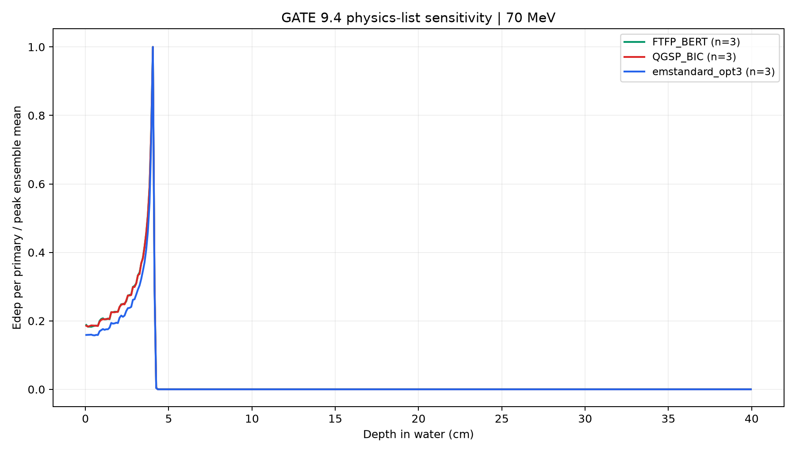
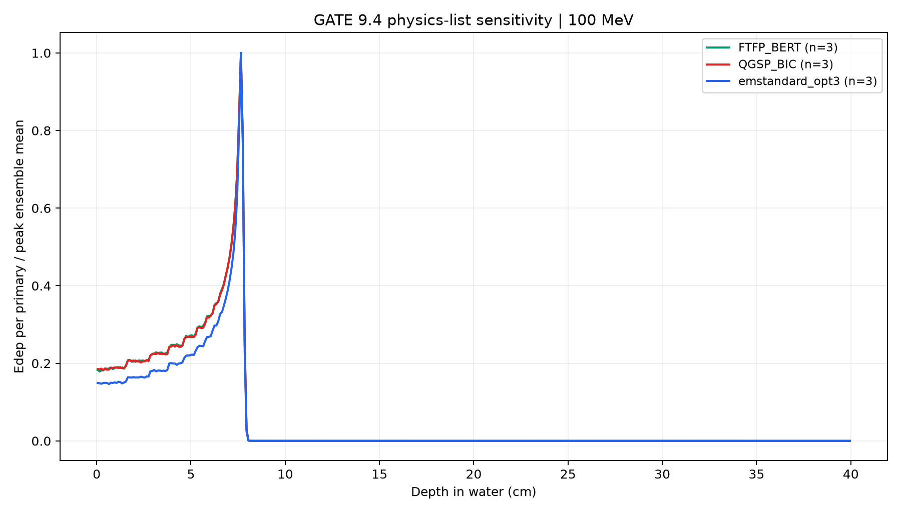
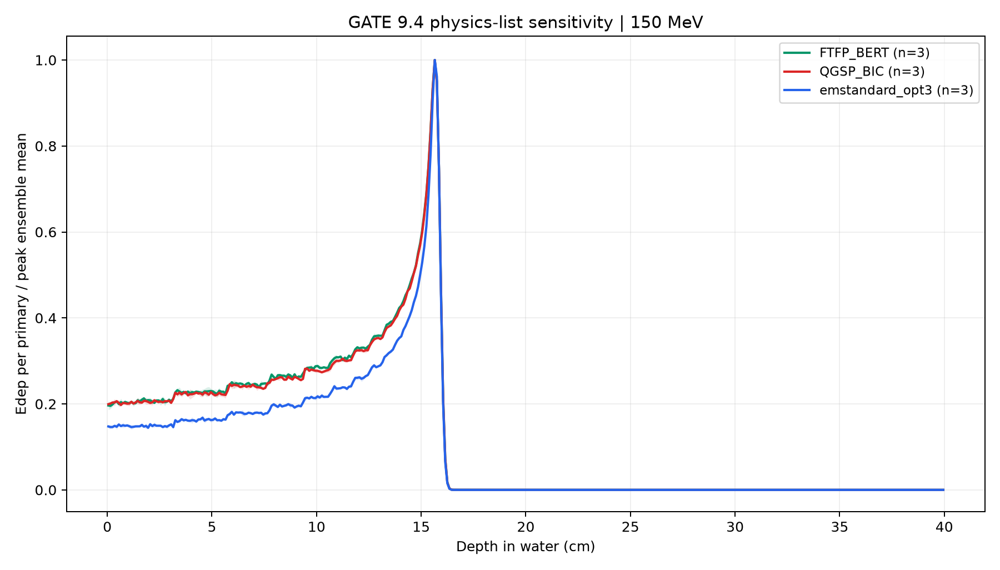
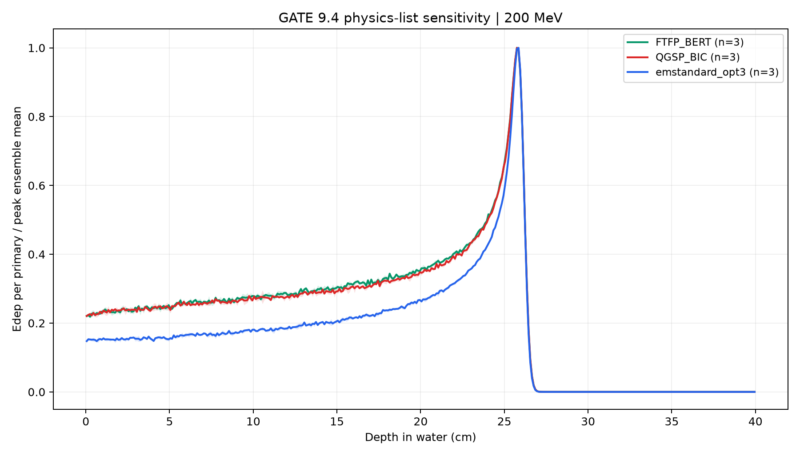
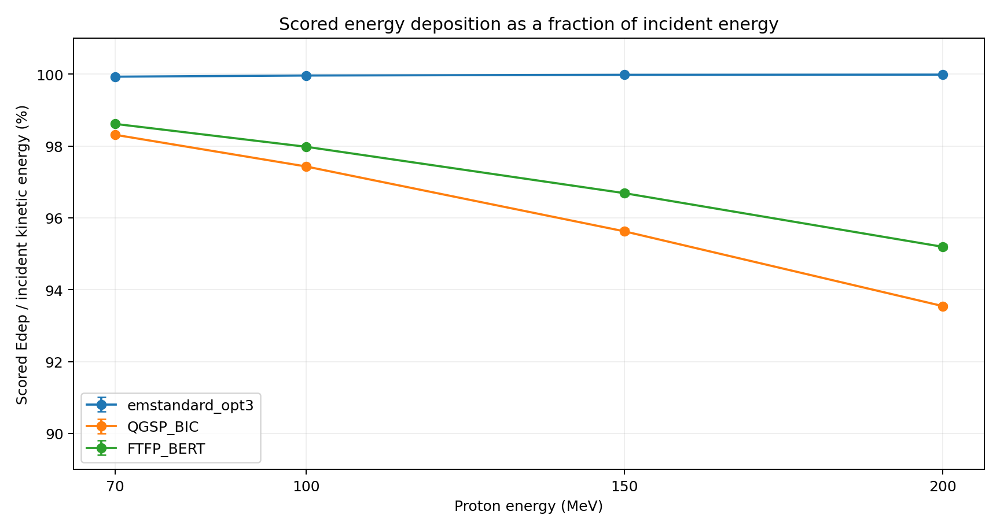
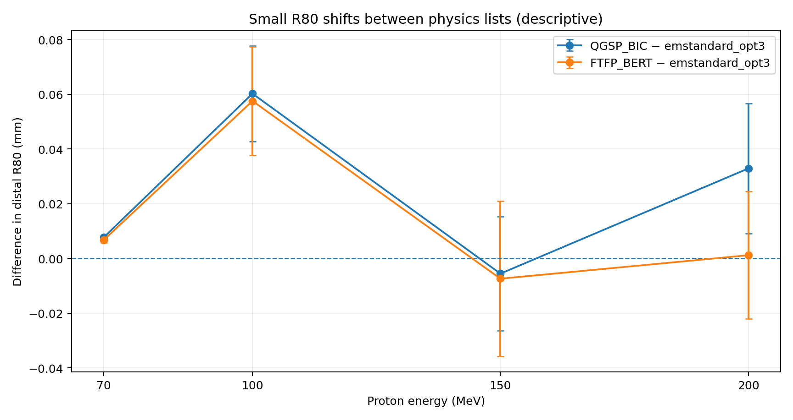
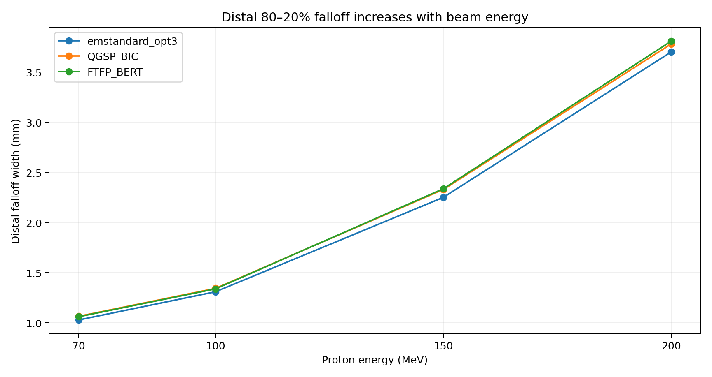

# GATE 9.4 — Physics-list sensitivity of proton Bragg peaks

**Evidence status:** User-provided outputs from 36 completed GATE 9.4 / Geant4 11.2.2 Monte Carlo runs, analyzed as a *research benchmark*; not validated clinical dosimetry.

**Campaign:** 4 proton energies × 3 physics configurations × 3 independently seeded runs × 50,000 primaries = **1,800,000 proton histories**.

> **Scope:** the uploaded tables and plots were analyzed directly. Original per-run `.mhd` / `.raw` volumes, GATE full logs and event-level secondaries were **not** included in this supplementary archive. A successful status file supports completion, but it does not itself establish simulation accuracy.

## At a glance

| Experiment dimension | Specification |
|---|---|
| Energies | 70, 100, 150, 200 MeV |
| Physics configurations | `emstandard_opt3`, `QGSP_BIC`, `FTFP_BERT` |
| Runs per configuration and energy | 3 (unique random seeds) |
| Primaries per run | 50,000 |
| Scored volume | 400 mm water along the beam axis, 400 longitudinal bins (1 mm) |
| Beam direction | −x (depth reconstructed from entrance) |
| Main observables | Energy deposition per primary, peak-bin position, distal R80 and R20, R80–R20 falloff |

## Key finding

**Physics-list choice affects total scored energy deposition more strongly than distal R80 under this setup.** With hadronic lists, the deposited-energy fraction decreases with increasing beam energy; the extracted distal R80 values remain close to the EM-only reference. The difference is most visible at 200 MeV: **QGSP_BIC scored 187.088 MeV per primary vs 199.976 MeV for emstandard_opt3 (−6.45%)**, while its mean distal R80 was only **+0.033 mm** relative to the EM reference.

This result describes **physics-list sensitivity**, not a clean isolation of nuclear interactions. Reference hadronic lists also carry electromagnetic-physics configurations; they should not automatically be interpreted as the same EM package plus one additional interaction.

## Quantitative results

### Distal R80: run mean ± across-run sample SD (mm)

| Energy (MeV) | emstandard_opt3 | QGSP_BIC | FTFP_BERT |
|---|---|---|---|
| 70 | 40.781 ± 0.000 | 40.789 ± 0.001 | 40.788 ± 0.001 |
| 100 | 77.346 ± 0.014 | 77.407 ± 0.010 | 77.404 ± 0.014 |
| 150 | 158.249 ± 0.014 | 158.243 ± 0.015 | 158.241 ± 0.025 |
| 200 | 260.529 ± 0.016 | 260.562 ± 0.017 | 260.530 ± 0.017 |


### Total scored Edep per primary (MeV)

| Energy (MeV) | emstandard_opt3 | QGSP_BIC | FTFP_BERT |
|---|---|---|---|
| 70 | 69.951 | 68.820 | 69.032 |
| 100 | 99.963 | 97.431 | 97.980 |
| 150 | 149.973 | 143.438 | 145.032 |
| 200 | 199.976 | 187.088 | 190.388 |


### Differences versus emstandard_opt3

| Energy (MeV) | ΔR80 QGSP_BIC (mm) | ΔR80 FTFP_BERT (mm) | ΔEdep QGSP_BIC (%) | ΔEdep FTFP_BERT (%) |
|---|---|---|---|---|
| 70 | +0.008 | +0.007 | -1.62% | -1.31% |
| 100 | +0.060 | +0.058 | -2.53% | -1.98% |
| 150 | -0.006 | -0.007 | -4.36% | -3.29% |
| 200 | +0.033 | +0.001 | -6.44% | -4.79% |


### Distal 80–20% falloff width (mm)

| Energy (MeV) | emstandard_opt3 | QGSP_BIC | FTFP_BERT |
|---|---|---|---|
| 70 | 1.029 | 1.066 | 1.062 |
| 100 | 1.310 | 1.344 | 1.339 |
| 150 | 2.251 | 2.330 | 2.337 |
| 200 | 3.701 | 3.780 | 3.808 |


## Results gallery

| Physics-list profiles: 70 MeV | Physics-list profiles: 100 MeV |
|---|---|
|  |  |
| Physics-list profiles: 150 MeV | Physics-list profiles: 200 MeV |
|  |  |

| Scored energy fraction | R80 shift versus electromagnetic reference |
|---|---|
|  |  |



> **Figure interpretation:** the original profile plots are normalized **separately for each physics-list/energy ensemble to its own peak**, and therefore cannot be used by themselves to compare absolute deposited energy or dose. Use the `edep_MeV_per_primary` values in the CSV tables for that comparison.

## Interpretation and limitations

1. **R80 is not CSDA range.** This is a profile crossing from the distal side of the simulated, discretized energy-deposition curve, not the continuous-slowing-down approximation range.
2. **Peak-bin depth is grid limited.** The reported peak depths come from 1 mm bins. Interpolating R80 to more decimal places does not establish sub-0.1 mm physical accuracy.
3. **Uncertainty type matters.** The group CSV provides across-run sample standard deviations, standard errors, and Student's t (df=2) intervals across only three independent seeds. It excludes scoring-resolution, beam-model, material, geometry, cross-section and other systematic effects.
4. **Energy budget is not particle-balance proof.** Lower energy scored in the water may reflect altered interaction histories, energy transported by secondaries, leakage out of the sensitive water, or other scored/physics differences. It cannot be attributed quantitatively to any specific nuclear product from these tables alone.
5. **Hadronic comparison is not controlled process subtraction.** Each reference physics list has its own configuration. A targeted sensitivity study should verify the EM constructors, production cuts and hadronic settings used by this specific Geant4 build.
6. **No clinical calibration.** The outcome is energy deposition (MeV) in a simplified water-scoring arrangement, not measured dose-to-water in Gy or patient-specific dose.
7. **Input provenance:** this supplemental package is based on shared CSV summaries and plots. It does not independently reproduce the 36 runs or re-read their volumetric `.raw` files.

## Suggested next experiment

To turn these observations into a defensible quantitative benchmark, perform a **scoring-resolution convergence study** at 150 and 200 MeV using identical geometry and larger statistics. Separately, add a proton/secondary-particle balance: number of exiting primary protons, neutrons, prompt photons, secondary charged particles and deposited energy inside/outside the scored volume. Compare EM variants consistently and benchmark in water against evaluated range measurements.

See [Follow-up experiment design](docs/NEXT_EXPERIMENTS.md) and [Methods](docs/METHODS_AND_LIMITATIONS.md).

## Files

- `data/run_metrics.csv`: all 36 run-level metrics and seeds
- `data/group_statistics.csv`: 12 groups × 5 metrics, sample SD/SEM/Student t intervals
- `data/physics_differences.csv`: differences of group means and combined SEM (not a CI)
- `data/baseline_vs_new_em.csv`: previous one-run comparison against the new EM replicates
- `data/analysis_status.json`: analysis completion and scope record
- `figures/`: original user-provided comparison plots and three additional summary figures
- `verify_results.py`: standard-library integrity checker for the extracted data
- `SHA256SUMS.txt`: SHA-256 digests for the archived source data and figures

## Reproduce the checks

```bash
python3 verify_results.py
```

**External physics-list references:** [Geant4 11.2 Physics List Guide](https://geant4.web.cern.ch/documentation/pipelines/master/plg_html/PhysicsListGuide/physicslistguide.html), [QGSP_BIC](https://geant4.web.cern.ch/documentation/pipelines/master/plg_html/PhysicsListGuide/reference_PL/QGSP_BIC.html), [FTFP_BERT](https://geant4.web.cern.ch/documentation/dev/plg_html/PhysicsListGuide/reference_PL/FTFP_BERT.html).

**Researcher:** Burhan Karaduman, Department of Physics, Middle East Technical University (METU), Türkiye.
