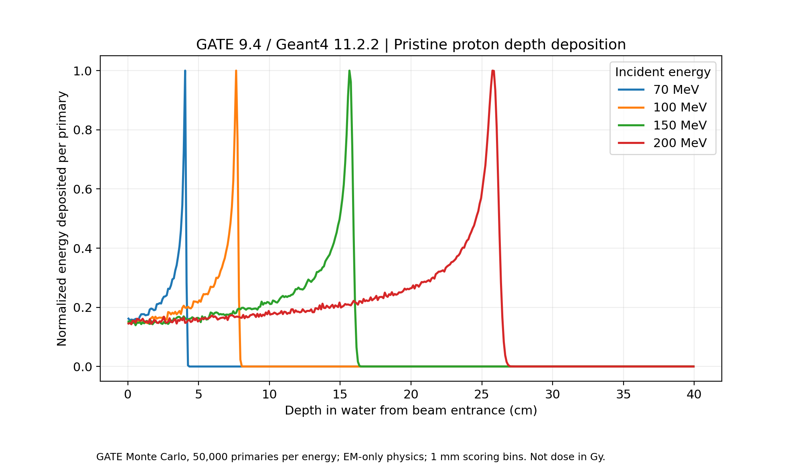
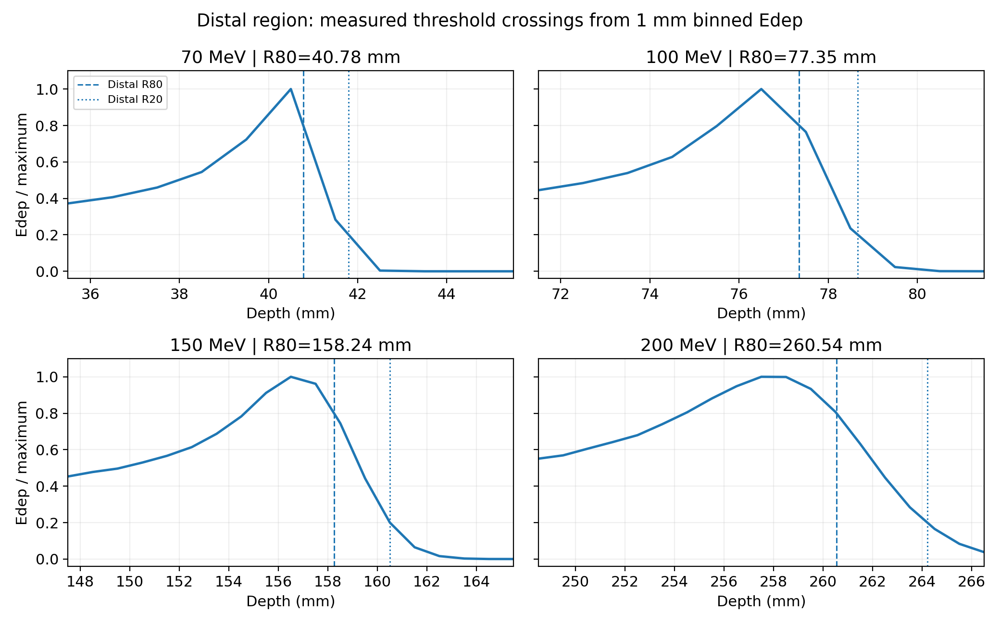
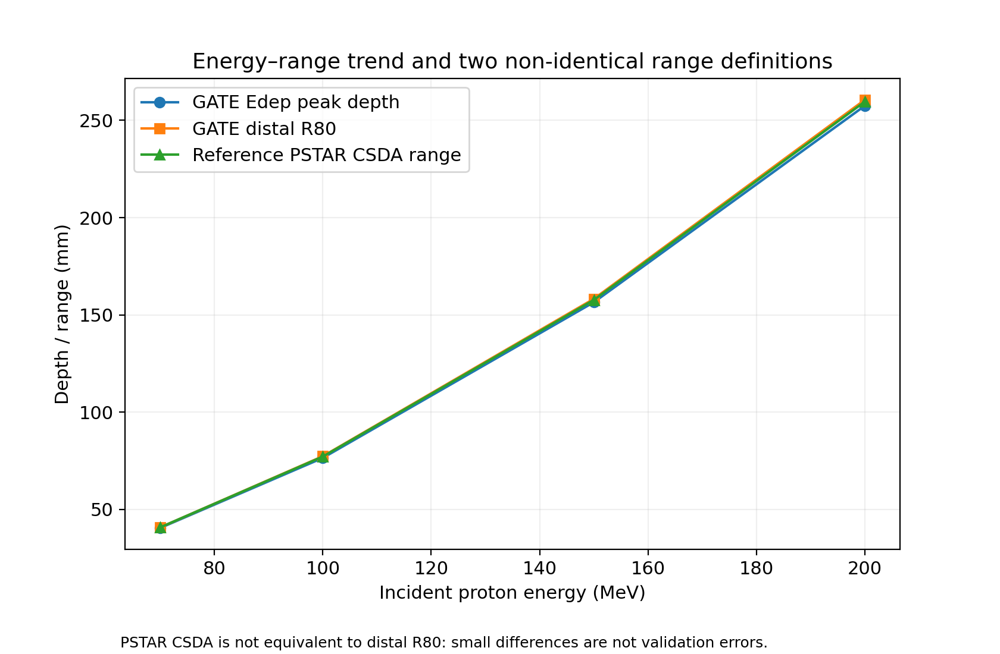
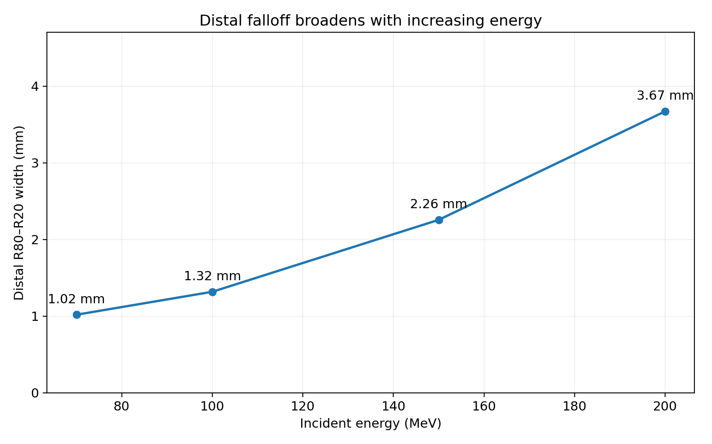

# GATE 9.4 Pristine Proton Bragg Peaks — 50,000-Primary Water Benchmark

> **Evidence status: completed GATE Monte Carlo runs, analyzed from user-supplied CSV output.** Four runs, each with 50,000 primary protons, were executed by the researcher in a WSL GATE 9.4 environment (Geant4 11.2.2). This report was generated from submitted depth-profile and summary CSV files; the original `.mhd` / `.raw` dose-actor output volumes and run logs were not re-executed or independently inspected in this report.

## At a glance

- Incident energies: **70, 100, 150, 200 MeV**; **200,000 primaries in the 50k campaign**.
- Geometry: **homogeneous 40 cm water box**, point-like monoenergetic proton source traveling along **−x**; 1 mm scoring bins along beam, 20 cm × 20 cm transverse scoring region.
- Physics selection in the benchmark macro: `emstandard_opt3` (**electromagnetic-only configuration**, not a comprehensive hadronic therapy calculation).
- Observables: **energy deposition per incident primary per 1 mm slice**, summed over the transverse scoring plane. **Not absorbed dose in Gy**.
- Data source: `summary_original.csv`, `E070_N50000_R0_profile.csv`, `E100_N50000_R0_profile.csv`, `E150_N50000_R0_profile.csv`, `E200_N50000_R0_profile.csv`.

## Primary result

### Depth metrics

| Energy (MeV) | Peak depth (mm) | Distal R80 (mm) | Distal R20 (mm) | R80–R20 (mm) | PSTAR CSDA range (mm) | R80 − CSDA (mm)† | Integrated Edep (MeV/primary) |
|---:|---:|---:|---:|---:|---:|---:|---:|
| 70 | 40.5 | 40.779 | 41.798 | 1.019 | 40.80 | -0.021 | 69.952 |
| 100 | 76.5 | 77.350 | 78.668 | 1.318 | 77.18 | +0.170 | 99.962 |
| 150 | 156.5 | 158.244 | 160.500 | 2.256 | 157.70 | +0.544 | 149.973 |
| 200 | 257.5 | 260.537 | 264.208 | 3.671 | 259.60 | +0.937 | 199.978 |

† **These two quantities are not the same observable.** The difference is descriptive only; it is **not** a percentage accuracy or quantitative validation of the physics model.

### Additional visualizations

| Distal falloff detail | Energy-dependent range |
|:--:|:--:|
|  |  |

## Interpretation

1. **The peak shifts deeper as energy rises.** The energy-deposition maximum moves from 40.5 mm at 70 MeV to 257.5 mm at 200 MeV.
2. **The distal edge broadens.** R80–R20 rises from ~1.02 mm to ~3.67 mm; this is consistent with increased range-straggling and transport effects but is also sensitive to the 1 mm scoring bin size and the crossing interpolation.
3. **The curves are visibly Bragg-like and reasonably smooth.** This supports that the scored energy deposition follows the expected qualitative pattern for monoenergetic protons in water.
4. **Integrated deposited energy per primary is nearly the full initial energy** (~99.93%–99.99% in the four supplied CSVs). This is a useful consistency observation for the **EM-only** water-box setup; it should not be extrapolated to a model including nuclear interactions or secondary escape.
5. **Do not interpret proximity to the PSTAR CSDA range as validation.** CSDA range, dose R80, and peak depth are different descriptors and must not be conflated.

## 5,000 vs 50,000 primary comparison (terminal output supplied by researcher)

| Energy | R80 shift, 50k − 5k (mm) |
|---:|---:|
| 70 MeV | +0.000 |
| 100 MeV | +0.001 |
| 150 MeV | −0.008 |
| 200 MeV | −0.061 |

**Important statistical limitation:** In the campaign generator, both stages for a given energy use the **same RNG seed**. Their event streams are therefore not independent if run configuration and execution are otherwise identical. The differences above **are not independent-sample uncertainty estimates**, and single-seed comparisons do not establish precision to 0.001 mm. Use genuinely independent random seeds for repeated-run uncertainty analysis.

## Methods and reproducibility

The original analysis script scores Edep from the GATE DoseActor using the output `.mhd + .raw` MetaImage arrays, sums across transverse dimensions, reverses x to match beam propagation from the +x water entrance, divides by the number of simulated primary protons, then interpolates the first distal crossing at 80% and 20% of the maximum slice Edep.

**Scoring details:** 400 x-slices × 1 mm = 400 mm longitudinal length. For plots, the individual depth curves are normalized to their respective maximum, so the normalized graph is unsuitable for comparison of absolute Edep yields across energies.

**What is not available in this evidence update:** original GATE `.raw/.mhd` source volumes, `run.mac`, full GATE logs, initialization environment snapshots, independent replicated seeds, and a verified hadronic physics comparison. The user has those run outputs locally in WSL and can export them separately.

## Next experiments, ranked

1. **Independent repeat runs:** at least three distinct seeds per energy, e.g. 50,000 primaries per seed, then report mean and sample SD of R80. Keep the complete seed list.
2. **Hadronic-physics sensitivity:** compare `emstandard_opt3` with a GATE-supported hadronic list such as `QGSP_BIC` or `FTFP_BERT`, with identical beam/geometry/scoring and independent RNG seeds; verify list availability and Geant4 data dependencies before launching a large campaign. [GATE 9.4 physics-list guide](https://opengate.readthedocs.io/en/v9.4/setting_up_the_physics.html).
3. **Resolution convergence:** compare 0.5, 1.0 and 2.0 mm scoring bins with sufficient histories. Avoid precision claims below the effective scoring resolution without validated bias correction.
4. **More realistic beam setup:** finite spot size, finite energy spread, particle angular spread and, if warranted, full SOBP energy-layer weighting.
5. **Range validation:** benchmark like-for-like quantities from simulated depth-dose against measured water-tank profiles. Compare true CSDA predictions with the appropriate transport-observable definitions rather than direct R80-to-CSDA residuals.
6. **Full reproducibility:** archive the original `.mhd/.raw`, macros, generator settings, log, exact GATE/Geant4 versions, seeds, material DB and processing version. Avoid uploading huge raw data directly to the normal Git repository; use release assets, Git LFS or an archival DOI dataset if suitable.

## External reference material

- [NIST PSTAR — Stopping-power and proton range tables](https://physics.nist.gov/PhysRefData/Star/Text/PSTAR.html)
- [NIST water proton stopping/range table](https://nvlpubs.nist.gov/nistpubs/Legacy/IR/nistir5330.pdf)
- [GATE v9.4 physics list configuration](https://opengate.readthedocs.io/en/v9.4/setting_up_the_physics.html)

*Research-only software/data. Not a clinically validated treatment-planning system.*
